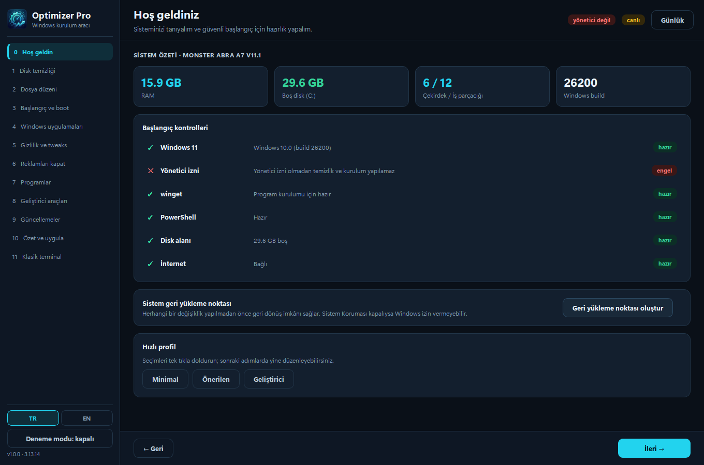
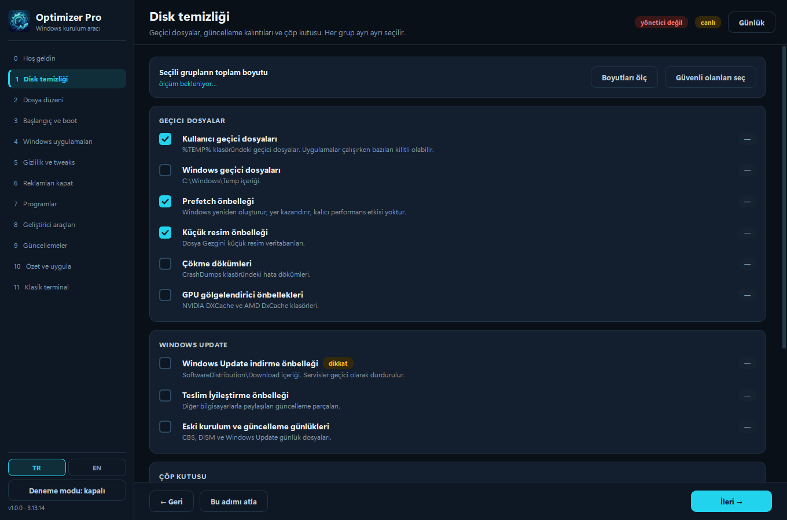
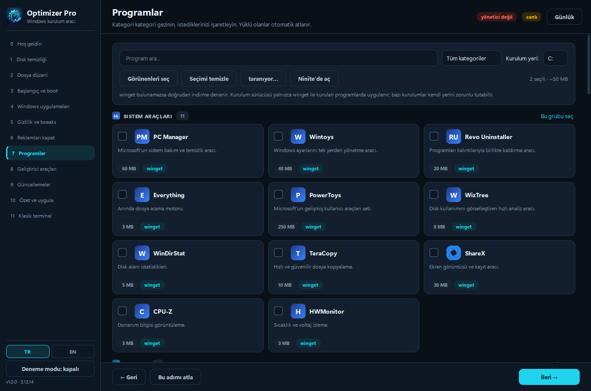
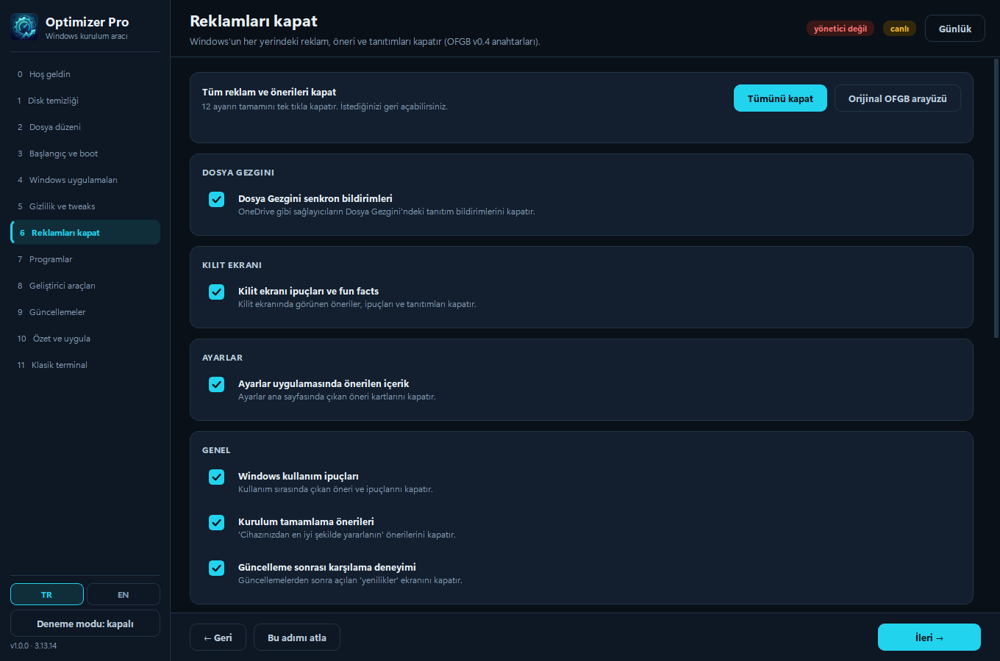
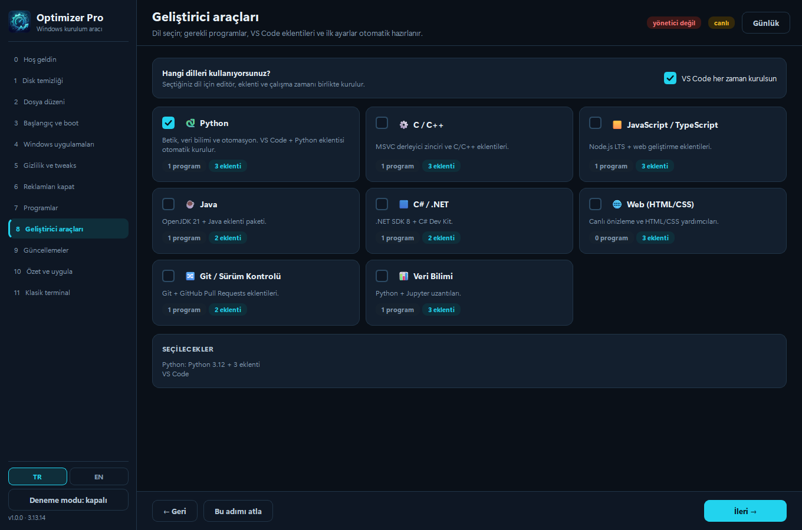
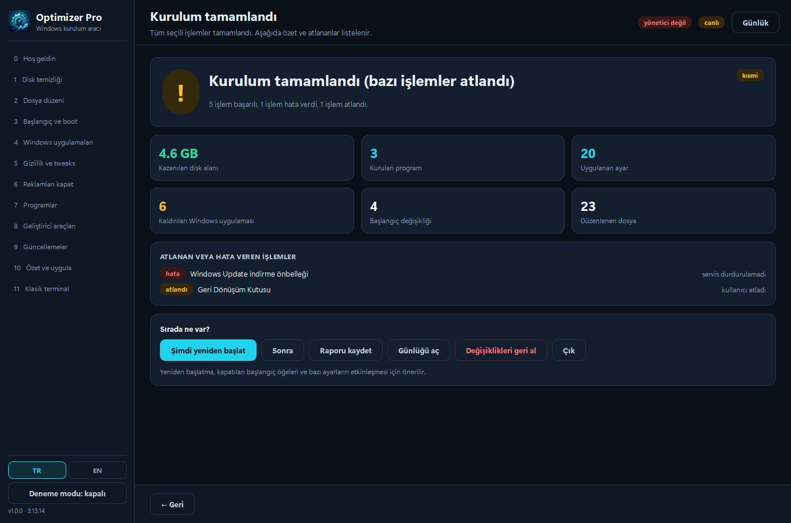

<div align="center">


# Optimizer Pro

**Windows setup, cleanup and optimization tool — one EXE, 13-step wizard.**

Prepares a freshly installed PC in a single pass: removes junk files, tidies startup apps,
turns off Windows ads, bulk-installs programs and scans for driver/Windows updates.

[🇹🇷 Türkçe](README.md) · **🇬🇧 English**

[](#)
[](#)
[-41CD52?logo=qt&logoColor=white)](#)
[](#)
[](LICENSE)

[**⬇️ Download Optimizer Pro**](https://github.com/Wyzuee/OptimizerPro/releases/tag/Release_1.0.0_OptimizerPro)

</div>

---

## ✨ Features

| | |
|---|---|
| 🧭 **13-step wizard** | "Skip this step" on every page, back/next navigation. Selections persist between sessions. |
| 🧹 **Disk cleanup** | Temp, Prefetch, thumbnail cache, crash dumps, GPU caches, Windows Update cache, Delivery Optimization, logs, recycle bin, Windows.old, DISM. With size pre-measurement. |
| 🗂️ **File organization** | Desktop/Downloads scan, category groups, selective **move to Recycle Bin**, optional subfolder classification. |
| 🚀 **Startup management** | Run / RunOnce / StartupApproved / Startup folder / logon tasks. Nothing is deleted — entries are only disabled. |
| ⚙️ **Boot settings** | Boot menu timeout; `numproc` (msconfig advanced) locked and warned, with a `bcdedit` backup. |
| 🪟 **Windows apps** | Appx list with sizes, critical packages locked, selective removal (optionally for new accounts too). |
| 🛡️ **Privacy / tweaks** | **54 Win11Debloat** settings, build gating (`min_build`), command preview, `-WhatIf` support. |
| 📵 **Turn off ads** | The same **12 settings / 16 registry keys** as **OFGB v0.4**, applied natively, plus a launcher for the official OFGB app. |
| 📦 **Bulk program install** | **70 apps / 10 categories**, real brand logos, "installed" detection with auto-skip, install-drive selection, Ninite integration. |
| 👨‍💻 **Developer chains** | Python · C/C++ · JS/TS · Java · .NET · Web · Git · Data Science → VS Code + extensions + pip/npm/pnpm automatically. |
| 🔄 **Updates** | Windows Update COM scan, drivers on a separate tab, selective install, `pnputil` inventory and driver backup, manufacturer support links. |
| 🖥️ **Classic terminal** | The legacy console tool embedded in a panel: live output, Y/N buttons, cancel. |
| 🏁 **Setup complete** | Reclaimed space, installed programs, skipped items **and why**, MD/HTML report, undo, restart. |
| 🌐 **Turkish / English** | Bilingual UI, instant switch from the sidebar, automatic choice based on Windows language. |

---

## 📸 Screenshots

<div align="center">

| Welcome | Disk cleanup | Programs |
|---|---|---|
|  |  |  |

| Turn off ads | Developer tools | Setup complete |
|---|---|---|
|  |  |  |

</div>

---

## 🚀 Installation

### End users

1. Open the [**Download Optimizer Pro**](https://github.com/Wyzuee/OptimizerPro/releases/tag/Release_1.0.0_OptimizerPro) page.
2. Download `Optimizer Pro.exe`.
3. Double-click it — Windows will ask for administrator rights (required for cleanup and installation).
4. Follow the wizard. You can skip any step.

> It is a single file and needs no installation. No Python or other dependency required.

### Safe first run

Turn the `Dry-run` toggle in the sidebar **on**. This mode changes nothing and only logs
every command it would run. It is recommended for the first use.

---

## 💻 Command line

| Parameter | Effect |
|---|---|
| `--dry-run` | Changes nothing, logs every command |
| `--skip-admin-check` | Does not request admin rights or self-elevate |
| `--page N` | Opens at the given step (0–11) |
| `--lang tr\|en` | Forces the UI language |
| `--version` | Prints the version |

The binary is built with a `requireAdministrator` manifest, so Windows shows the UAC prompt
on double-click. Without admin rights, cleanup/installation/startup actions fall back to
read-only mode.

---

## 🛡️ Safety and rollback

- **Preflight:** Windows version, admin rights, internet, `winget`, PowerShell, free disk, pending reboot.
- **System restore point:** Created before the first change (skipped if one exists within 24 hours).
- **Undo:** Registry writes store the previous value in `undo.json`; file moves are backed up; `.bcd` is exported before `bcdedit` changes. "Undo changes" replays these records.
- **Deletion policy:** Files go to the **Recycle Bin**. Irreversible actions (Windows.old, DISM) carry a warning badge and are not selected by default.
- **Build gating:** Windows 11-only settings appear greyed out and disabled on Windows 10.
- **Failure isolation:** Every task runs in its own `try/except`; if one fails the queue continues and the failure is reported.
- **Command safety:** No `shell=True`, arguments are passed as lists, external input is never interpolated into a command.
- **Verification:** The official OFGB download is verified against a pinned SHA256 hash and is never executed if it does not match.
- **Privacy:** The app sends no telemetry. Network access is limited to GitHub, ninite.com, winget sources and manufacturer sites.

Logs live in `%LOCALAPPDATA%\OptimizerPro\logs\`, reports in `...\reports\`, backups in
`...\backups\`.

---

## 🧱 Architecture

```
app/
  main.py                entry point, UAC, single-instance lock, crash capture
  core/                  paths · logger · ps (PowerShell) · state · undo · registry
                         tasks (engine) · preflight · elevation · download · restore
                         i18n (translations + data overlays)
  modules/               sysinfo · cleanup · file_review · startup · bootcfg · appx
                         power · ofgb · debloat · catalog · installer · ninite
                         devtools · updates · drivers
  ui/                    theme (QSS) · widgets · icons · translator · shell · pages/
  data/                  catalog.json · cleanup_targets.json · ofgb_tweaks.json
                         debloat_tweaks.json · appx_blocklist.json · dev_rules.json
                         *.en.json (English overlays)
  i18n/                  en.json (UI strings)
  assets/                app.ico · logo.png · check.png · icons/ (43 logos)
tools/Optimizer.exe      legacy console tool (embedded terminal)
build/                   build.py · fetch_icons.py · make_icons.py · version_info.txt
tests/                   smoke_ui.py · dryrun_pipeline.py · test_i18n.py
```

- **50+ Python files**, 6 JSON data files plus the English overlays
- UI: PySide6 (Qt6) + QSS dark theme, `QThread`/`Signal` keeps the UI responsive
- Packaging: PyInstaller `--onefile --windowed --uac-admin`

---

## 🛠️ Development

```powershell
# 1) Virtual environment (Python 3.13 recommended)
python -m venv .venv
.\.venv\Scripts\python.exe -m pip install -r requirements.txt

# 2) Run in development mode
.\.venv\Scripts\python.exe app\main.py

# 3) Dry-run mode
.\.venv\Scripts\python.exe app\main.py --dry-run

# 4) English UI
.\.venv\Scripts\python.exe app\main.py --lang en

# 5) Build the single exe
.\.venv\Scripts\python.exe build\build.py
```

### Tests

```powershell
$env:QT_QPA_PLATFORM = "offscreen"
.\.venv\Scripts\python.exe tests\smoke_ui.py              # 13 pages + task planning
.\.venv\Scripts\python.exe tests\dryrun_pipeline.py       # 12 tasks in dry-run
.\.venv\Scripts\python.exe tests\test_i18n.py             # TR/EN data overlays
.\.venv\Scripts\python.exe tests\check_page_texts.py      # missing translations
```

Destructive behaviour must be tested **in a virtual machine only**. The bundled tests run
with `--dry-run` and read-only scans.

### Adding a translation

1. Write the new string in code as `t("Türkçe metin")`.
2. Add `"Türkçe metin": "English text"` to `app/i18n/en.json`.
3. Run `tests/check_page_texts.py` to verify nothing is missing.

If a translation is missing the app falls back to the Turkish string — no blank labels or
crashes.

### Data files

The program catalog, cleanup targets and tweak lists live in `app/data/*.json`. To add a
program, add a record to `catalog.json`; for its English text, add an entry with the same
`id` to `catalog.en.json`.

---

## 🤝 Contributing

Use [Issues](https://github.com/Wyzuee/OptimizerPro/issues) for bug reports and suggestions.
For pull requests:

- Ensure `python -m compileall app` and the test scripts pass
- Keep `--dry-run` support when adding destructive behaviour
- Wrap user-facing strings in `t()` and add the English translation to `en.json`

---

## 📜 License

[MIT](LICENSE) © 2026 Wyzuee

### Credits

- [Win11Debloat](https://github.com/Raphire/Win11Debloat) — MIT, Raphire · tweak parameters
- [OFGB](https://github.com/xM4ddy/OFGB) — MIT, xM4ddy · registry keys
- [Simple Icons](https://simpleicons.org) — CC0 · program logos

> Optimizer Pro is an independent tool and is not affiliated with Microsoft, Raphire or
> xM4ddy. As with any tool that changes system settings, use is at your own risk.
