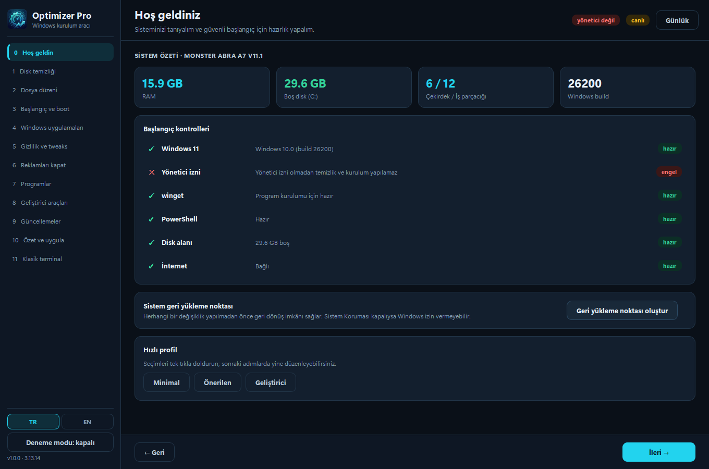
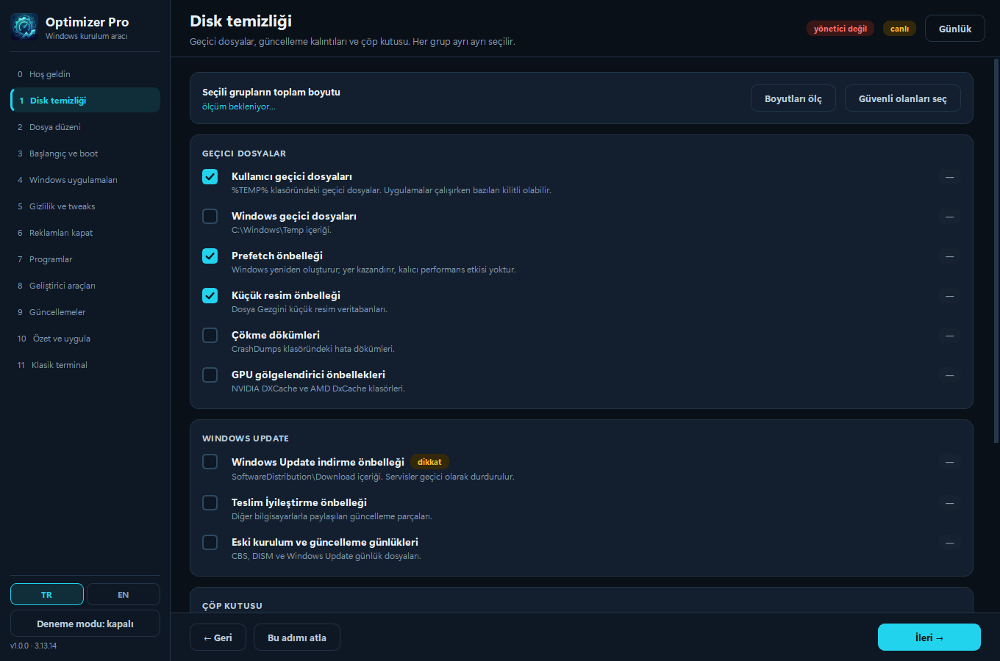
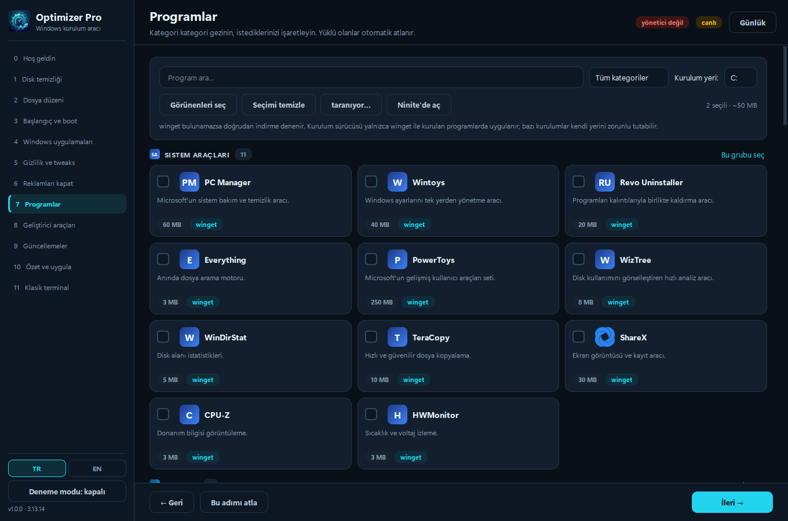
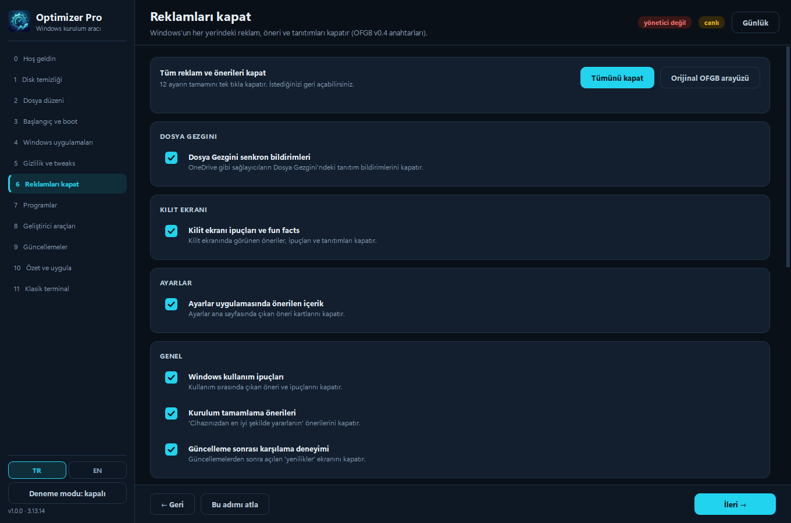
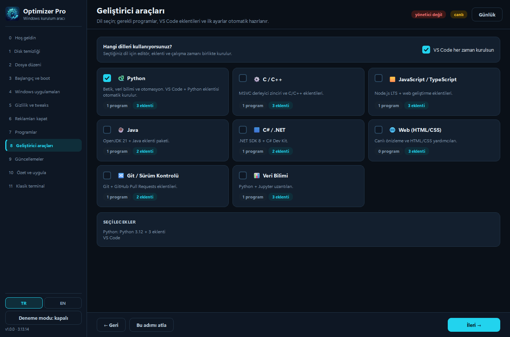
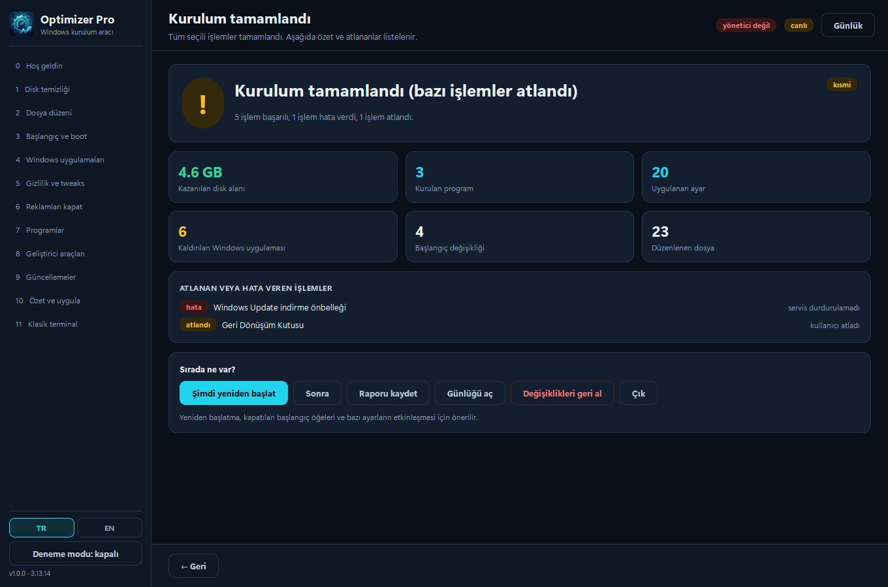

<div align="center">


# Optimizer Pro

**Windows kurulum, temizlik ve optimizasyon aracı — tek EXE, 13 adımlı sihirbaz.**

Sıfırdan kurulan bir bilgisayarı tek geçişte hazırlar: gereksiz dosyaları temizler,
başlangıç uygulamalarını düzenler, Windows reklamlarını kapatır, programları toplu kurar,
sürücü ve güncellemeleri tarar.

**🇹🇷 Türkçe** · [🇬🇧 English](README.en.md)

[](#)
[](#)
[-41CD52?logo=qt&logoColor=white)](#)
[](#)
[](LICENSE)

[**⬇️ Optimizer Pro'yu indir**](https://github.com/Wyzuee/OptimizerPro/releases/tag/Release_1.0.0_OptimizerPro)

</div>

---

## ✨ Özellikler

| | |
|---|---|
| 🧭 **13 adımlı sihirbaz** | Her adımda "Bu adımı atla", geri/ileri. Seçimler oturumlar arası saklanır. |
| 🧹 **Disk temizliği** | Temp, Prefetch, küçük resim önbelleği, çökme dökümleri, GPU önbellekleri, Windows Update önbelleği, Delivery Optimization, günlükler, geri dönüşüm kutusu, Windows.old, DISM. Boyut ön ölçümü ile. |
| 🗂️ **Dosya düzeni** | Masaüstü/İndirilenler taraması, kategori grupları, seçerek **geri dönüşüm kutusuna** silme, isteğe bağlı alt klasörlere sınıflandırma. |
| 🚀 **Başlangıç yönetimi** | Run / RunOnce / StartupApproved / Startup klasörü / oturum açma görevleri. Kayıt silinmez, yalnızca devre dışı bırakılır. |
| ⚙️ **Boot ayarları** | Önyükleme süresi; `numproc` (msconfig gelişmiş) kilitli ve uyarılı, `bcdedit` yedeğiyle. |
| 🪟 **Windows uygulamaları** | Appx listesi + boyutlar, kritik paketler korumalı, seçerek kaldırma (isteğe bağlı yeni hesaplar için de). |
| 🛡️ **Gizlilik / tweaks** | **54 Win11Debloat** ayarı, sürüm kapısı (`min_build`), komut önizleme, `-WhatIf` desteği. |
| 📵 **Reklamları kapat** | **OFGB v0.4** ile aynı **12 ayar / 16 registry anahtarı**, yerel uygulama + resmî OFGB'yi açma. |
| 📦 **Toplu program kurulumu** | **70 program / 10 kategori**, gerçek marka logoları, "yüklü" tespiti ve otomatik atlama, kurulum sürücüsü seçimi, Ninite entegrasyonu. |
| 👨‍💻 **Geliştirici zincirleri** | Python · C/C++ · JS/TS · Java · .NET · Web · Git · Veri Bilimi → VS Code + eklentiler + pip/npm/pnpm otomatik. |
| 🔄 **Güncellemeler** | Windows Update COM taraması, sürücüler ayrı sekmede, seçerek kurulum, `pnputil` envanteri ve sürücü yedeği, üretici destek linkleri. |
| 🖥️ **Klasik terminal** | Eski konsol aracı gömülü panelde: canlı çıktı, E/H butonları, iptal. |
| 🏁 **Kurulum tamamlandı** | Kazanılan alan, kurulan program, atlananlar **ve nedenleri**, MD/HTML rapor, geri alma, yeniden başlatma. |
| 🌐 **Türkçe / English** | Arayüz iki dilli; kenar çubuğundan anında geçiş, Windows diline göre otomatik seçim. |

---

## 📸 Ekran görüntüleri

<div align="center">

| Hoş geldin | Disk temizliği | Programlar |
|---|---|---|
|  |  |  |

| Reklamları kapat | Geliştirici araçları | Kurulum tamamlandı |
|---|---|---|
|  |  |  |

</div>

---

## 🚀 Kurulum

### Son kullanıcı

1. [**Optimizer Pro'yu indir**](https://github.com/Wyzuee/OptimizerPro/releases/tag/Release_1.0.0_OptimizerPro) sayfasına gidin.
2. `OptimizerPro.exe` dosyasını indirin.
3. Çift tıklayın — Windows yönetici izni ister (temizlik ve kurulum için gereklidir).
4. Sihirbazı takip edin. Her adımı atlayabilirsiniz.

> Tek dosyadır, kurulum gerektirmez. Python veya başka bir bağımlılık gerekmez.

### İlk denemede güvenli mod

Kenar çubuğundaki `Deneme modu` düğmesini **açık** konuma getirin. Bu mod hiçbir değişiklik
yapmaz, yalnızca çalıştırılacak tüm komutları günlüğe yazar. İlk kullanımda bununla
başlamanız önerilir.

---

## 💻 Komut satırı

| Parametre | Etki |
|---|---|
| `--dry-run` | Hiçbir değişiklik yapmaz, tüm komutları günlüğe yazar |
| `--skip-admin-check` | Yönetici izni istemez, otomatik yükseltme yapmaz |
| `--page N` | Belirtilen adımla açılır (0–11) |
| `--lang tr\|en` | Arayüz dilini zorlar |
| `--version` | Sürümü yazdırır |

Program `requireAdministrator` manifestiyle derlenir: çift tıklamada Windows UAC istemi
otomatik çıkar. Yönetici izni yoksa temizlik/kurulum/başlangıç işlemleri salt okunur moda düşer.

---

## 🛡️ Güvenlik ve geri alma

- **Ön kontrol:** Windows sürümü, yönetici izni, internet, `winget`, PowerShell, boş disk, bekleyen yeniden başlatma.
- **Sistem geri yükleme noktası:** İlk değişiklikten önce (24 saat içinde varsa atlanır).
- **Geri alma:** Registry yazımlarında önceki değer `undo.json`'a kaydedilir; dosya taşımaları yedeklenir; `bcdedit` öncesi `.bcd` yedeği alınır. "Değişiklikleri geri al" bunları uygular.
- **Silme politikası:** Dosyalar **Geri Dönüşüm Kutusu'na** gider. Windows.old ve DISM gibi geri dönüşü olmayan işlemler uyarı rozetiyle işaretlidir ve varsayılan seçili değildir.
- **Sürüm kapısı:** Windows 11'e özel ayarlar Windows 10'da gri ve pasif görünür.
- **Hata izolasyonu:** Her görev kendi `try/except`'inde çalışır; biri patlarsa kuyruk devam eder ve iş raporlanır.
- **Komut güvenliği:** `shell=True` yok, argümanlar liste olarak geçirilir, dış girdi komuta gömülmez.
- **Doğrulama:** Resmî OFGB indirmesi SHA256 ile doğrulanır (pinlenmiş hash), eşleşmezse çalıştırılmaz.
- **Gizlilik:** Uygulama telemetri göndermez. Ağ erişimi yalnızca GitHub, ninite.com, winget kaynakları ve üretici siteleri içindir.

Günlükler `%LOCALAPPDATA%\OptimizerPro\logs\`, raporlar `...\reports\`, yedekler `...\backups\`
altına yazılır.

---

## 🧱 Mimari

```
app/
  main.py                giriş noktası, UAC, tek örnek kilidi, çökme yakalama
  core/                  paths · logger · ps (PowerShell) · state · undo · registry
                         tasks (motor) · preflight · elevation · download · restore
                         i18n (çoklu dil) · i18n veri katmanları
  modules/               sysinfo · cleanup · file_review · startup · bootcfg · appx
                         power · ofgb · debloat · catalog · installer · ninite
                         devtools · updates · drivers
  ui/                    theme (QSS) · widgets · icons · translator · shell · pages/
  data/                  catalog.json · cleanup_targets.json · ofgb_tweaks.json
                         debloat_tweaks.json · appx_blocklist.json · dev_rules.json
                         *.en.json (İngilizce katmanlar)
  i18n/                  en.json (arayüz çevirileri)
  assets/                app.ico · logo.png · check.png · icons/ (43 logo)
tools/Optimizer.exe      klasik konsol aracı (gömülü terminal)
build/                   build.py · fetch_icons.py · make_icons.py · version_info.txt
tests/                   smoke_ui.py · dryrun_pipeline.py · test_i18n.py
```

- **50+ Python dosyası**, 6 JSON veri dosyası + İngilizce katmanlar
- UI: PySide6 (Qt6) + QSS koyu tema, `QThread`/`Signal` ile UI donmaz
- Paketleme: PyInstaller `--onefile --windowed --uac-admin`

---

## 🛠️ Geliştirme

```powershell
# 1) Sanal ortam (Python 3.13 önerilir)
python -m venv .venv
.\.venv\Scripts\python.exe -m pip install -r requirements.txt

# 2) Geliştirme modunda çalıştır
.\.venv\Scripts\python.exe app\main.py

# 3) Deneme modu
.\.venv\Scripts\python.exe app\main.py --dry-run

# 4) İngilizce arayüz
.\.venv\Scripts\python.exe app\main.py --lang en

# 5) Tek exe derle
.\.venv\Scripts\python.exe build\build.py
```

### Testler

```powershell
$env:QT_QPA_PLATFORM = "offscreen"
.\.venv\Scripts\python.exe tests\smoke_ui.py              # 13 sayfa + plan üretimi
.\.venv\Scripts\python.exe tests\dryrun_pipeline.py       # 12 görev deneme modunda
.\.venv\Scripts\python.exe tests\test_i18n.py             # TR/EN veri katmanları
.\.venv\Scripts\python.exe tests\check_page_texts.py      # eksik çeviri kontrolü
```

Yıkıcı işlemler **yalnızca sanal makinede** test edilmelidir. Depodaki testler `--dry-run`
ve salt okunur taramalarla çalışır.

### Çeviri ekleme

1. Yeni metni koda `t("Türkçe metin")` olarak yazın.
2. `app/i18n/en.json` dosyasına `"Türkçe metin": "English text"` ekleyin.
3. `tests/check_page_texts.py` ile eksikleri kontrol edin.

Eksik çeviri olduğunda uygulama Türkçe metni gösterir — boş ekran veya hata olmaz.

### Veri dosyaları

Program kataloğu, temizlik hedefleri ve tweak listeleri `app/data/*.json` içinde tutulur.
Yeni bir program eklemek için `catalog.json`'a kayıt eklemek yeterlidir; İngilizce karşılığı
için `catalog.en.json`'a aynı `id` ile giriş ekleyin.

---

## 🤝 Katkı

Hata bildirimi ve öneriler için [Issues](https://github.com/Wyzuee/OptimizerPro/issues)
kullanılabilir. Pull request'lerde:

- `python -m compileall app` ve test betiklerinin geçtiğinden emin olun
- Yıkıcı davranış eklerken `--dry-run` desteğini unutmayın
- Kullanıcıya görünen metinleri `t()` ile sarın ve `en.json`'a çevirisini ekleyin

---

## 📜 Lisans

[MIT](LICENSE) © 2026 Wyzuee

### Teşekkürler

- [Win11Debloat](https://github.com/Raphire/Win11Debloat) — MIT, Raphire · tweak parametreleri
- [OFGB](https://github.com/xM4ddy/OFGB) — MIT, xM4ddy · registry anahtarları
- [Simple Icons](https://simpleicons.org) — CC0 · program logoları

> Optimizer Pro bağımsız bir araçtır; Microsoft, Raphire veya xM4ddy ile bağlantılı değildir.
> Sistem ayarlarını değiştiren her araçta olduğu gibi kullanım sorumluluğu kullanıcıya aittir.
